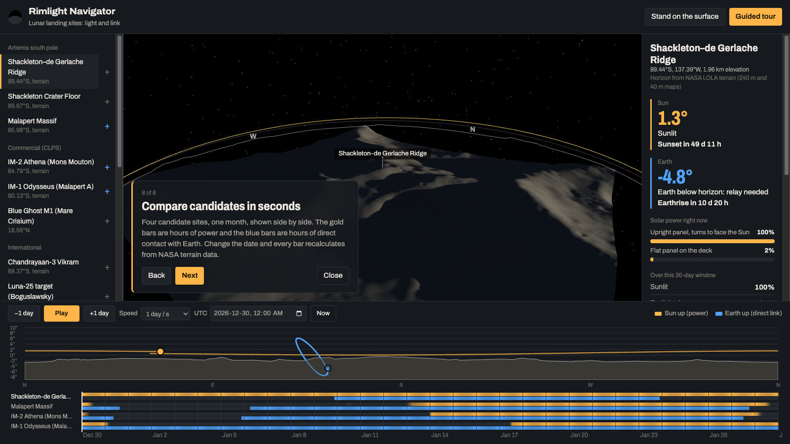

# Rimlight Navigator

**Team Rimlight**, NASA Space Apps Challenge 2026, challenge [*Lunar Landing Site Navigator*](https://www.spaceappschallenge.org/2026/challenges/lunar-landing-site-navigator/)

Pick a spot on the Moon and a date. Rimlight Navigator shows where the Sun and Earth sit relative to the **real terrain horizon** at that spot. It tells you how long until sunset (power) and Earthset (direct-to-Earth comms). You can also line up several candidate sites over a month and compare them side by side.

> At the lunar south pole the Sun never climbs more than about 1.5° above the horizon. A ridge a few hundred metres high can mean months of sunlight, and a crater 20 km away can mean none ever. Planning tools that do this math exist, but they are built for specialists. Rimlight puts the answer on one screen in seconds.



## What it does

| | |
|---|---|
| **3D surface view** | A 60 × 60 km patch of real NASA LOLA terrain around the site, lit by the Sun at its true position, so shadows are physically placed. You can switch to standing on the surface and look around. |
| **Sun & Earth on the sky** | Shows the true azimuth and elevation of both bodies, plus their paths over the next 30 days. Earth shows its correct phase. |
| **360° skyline panorama** | The horizon the lander actually sees, unrolled flat. You can tell at a glance whether the Sun clears the terrain. |
| **Light & link timeline** | 30 days of "Sun up" (gold) and "Earth up" (blue) bars for every site you're comparing. Click it to move through time. |
| **Countdowns** | Time until the next sunset or sunrise and Earthset or Earthrise, to the minute. |
| **Power estimate** | Output from an upright Sun-tracking panel versus a flat deck panel. This shows why polar landers mount their panels vertically. |
| **Mission metrics** | % of time sunlit, % with Earth in view, % with both, longest night, and longest comms blackout. |
| **14 curated sites** | Artemis south-pole candidates, CLPS landers (IM-1, IM-2, Blue Ghost), Apollo 11/15/17, Chandrayaan-3, SLIM, Chang'e 4/6, plus any custom coordinates. |
| **Guided tour** | An 8-scene story mode used as the live presentation (no slides). |

## Accuracy

* **Ephemeris:** Sun and Earth directions come from [Astronomy Engine](https://github.com/cosinekitty/astronomy) and are rotated into the Moon's body-fixed frame with the IAU rotation model. They are **checked against NASA JPL Horizons** for observers on the lunar surface: the worst error is **0.004°** across 3 sites × 2 bodies × 1 month (`npm run validate`).
* **Terrain horizons:** these come from **NASA LRO LOLA** polar elevation maps (`LDEM_85S_40M`, `LDEM_60S_240M`). The builder marches a ray outward to 300 km in 720 directions and accounts for lunar curvature. The Moon has no atmosphere, so there is no refraction term.
* **Sanity check against published results:** our numbers for 2027 put the Shackleton–de Gerlache ridge at **88.8% sunlit**, matching the ~86–89% reported in the literature. The Shackleton crater floor gets **0%**, consistent with it being a permanently shadowed region. The far-side Chang'e sites have **0% Earth visibility**, as expected.

The method is explained in [docs/SCIENCE.md](docs/SCIENCE.md).

## Run it

```bash
npm install
npm run dev          # http://localhost:5173
npm run build        # static site in dist/ (works offline / any static host)
npm run validate     # compare against JPL Horizons (needs internet)
```

Rebuilding the terrain data is optional, because the processed files are already in `public/data/sites/`:

```bash
python3 -m venv .venv && .venv/bin/pip install numpy pillow
bash scripts/fetch_dems.sh                 # ~235 MB of NASA LOLA data
.venv/bin/python scripts/build_horizons.py
node scripts/sanity-check.mjs              # one-year stats for every site
```

### Keyboard (for presenting)
`Space` play/pause · `←/→` ±1 hour · `Shift+←/→` ±1 day · `N`/`P` or PageDown/PageUp next/previous tour scene · `F` focus mode (hides side panels) · `Esc` close tour.
Deep links: `?tour=3`, `?site=malapert&t=2027-01-05T12:00&eye=1`.

## Data & resources

* NASA LRO **LOLA** gridded elevation data, PDS Geosciences Node (mirror: imbrium.mit.edu)
* NASA/JPL **Horizons** System, used as the validation reference
* NASA **Moon Trek** and ASU **LROC QuickMap**, used for reference while picking sites
* Astronomy Engine (MIT), Three.js (MIT), Archivo typeface (OFL)

## Project layout

```
src/core/       physics: ephemeris.js, horizon.js, analysis.js (no UI code)
src/            UI: main.js, scene.js (3D), panorama.js, timeline.js, story.js
src/data/       sites.json (curated sites, single source of truth)
public/data/    precomputed LOLA horizons + terrain patches
scripts/        DEM tools (Python), JPL validation + sanity checks (Node)
docs/           brief, plan, progress log, science notes, demo script, decisions
```

## Team

**Rimlight** is a solo team. The name comes from the crater rims at the lunar south pole that catch sunlight while everything around them is dark, which is exactly what this tool helps you find.

AI assistance disclosure: development was assisted by an AI coding assistant (Claude). All data comes from NASA sources and is validated as described above.

License: MIT
